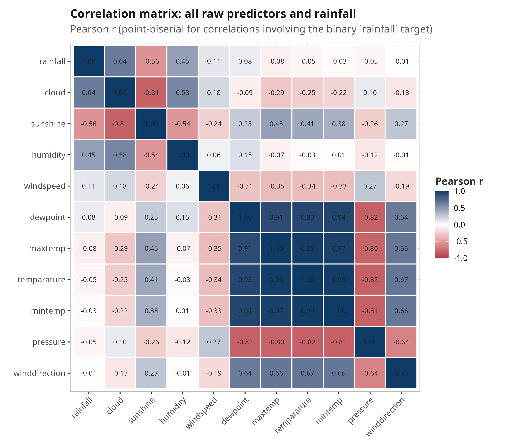
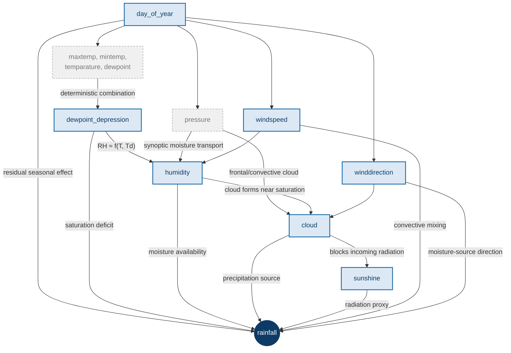
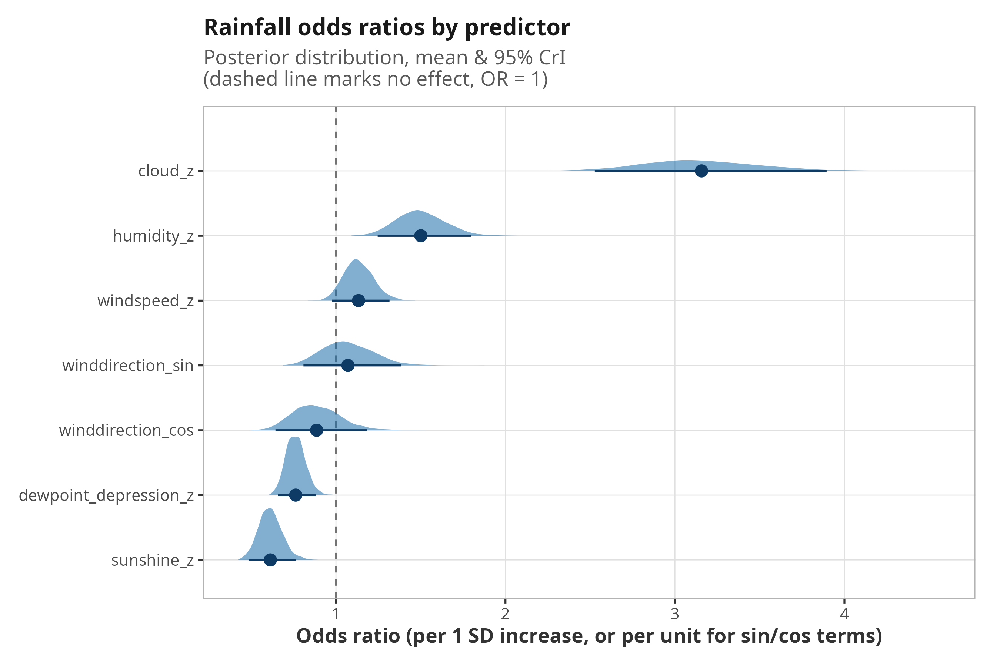
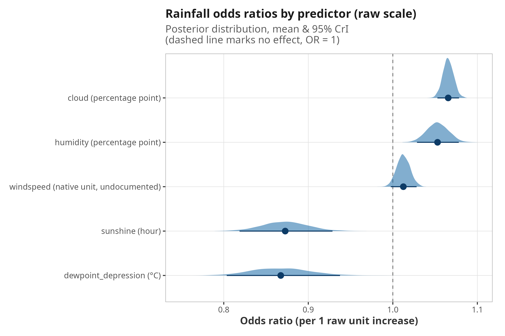
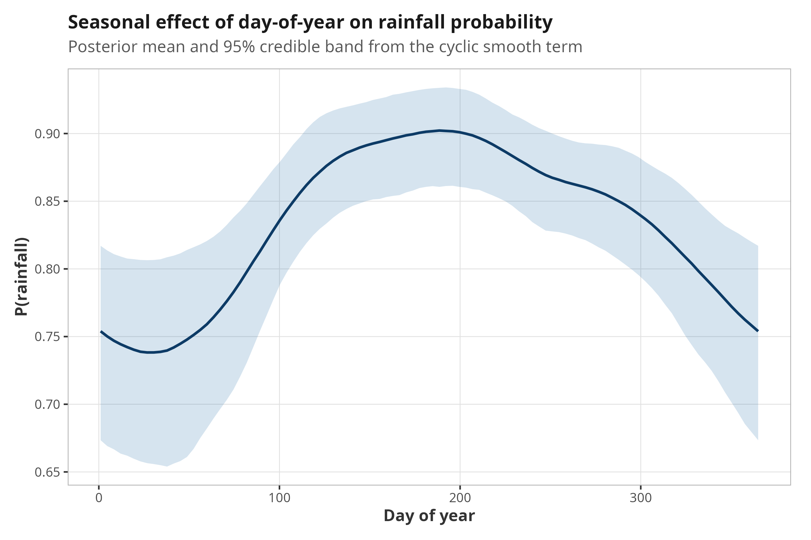
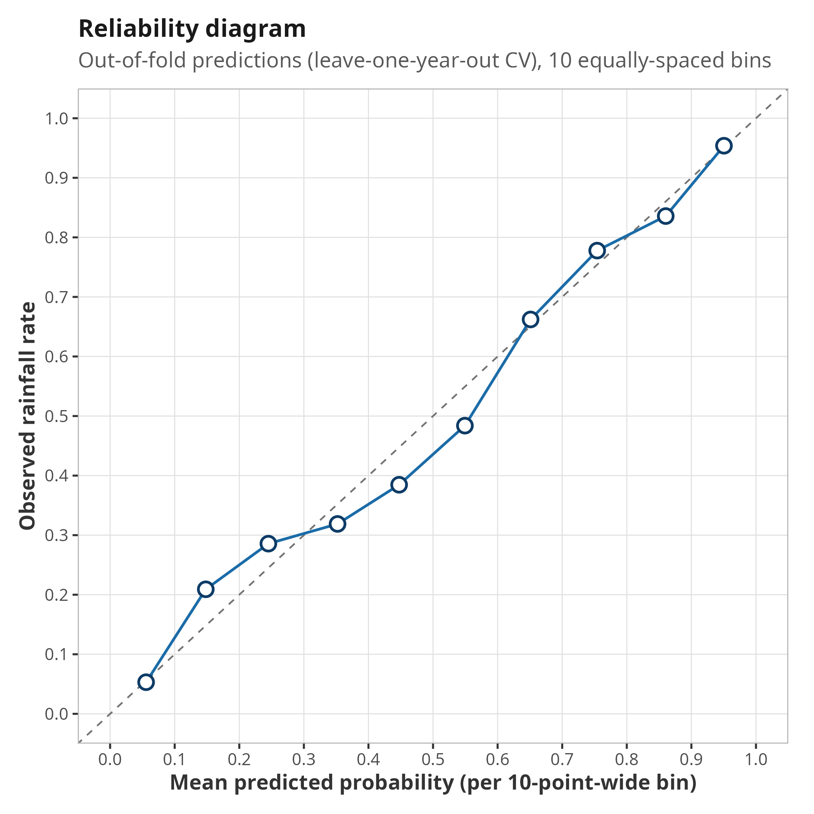
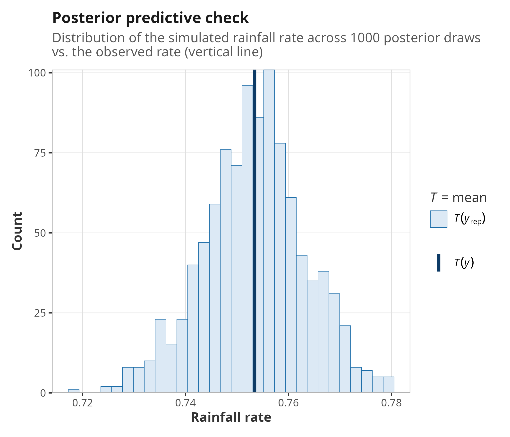

# Binary Prediction with a Rainfall Dataset — Bayesian logistic GAM

Kaggle competition: https://www.kaggle.com/competitions/playground-series-s5e3

## 1. Background

This project is part of the **Bayesian Kaggle Challenge**, a series of independent projects solved by using only **Bayesian Statistics**, where we focus on inference without giving up too much predictability.

This entry tackles [Binary Prediction with a Rainfall Dataset](https://www.kaggle.com/competitions/playground-series-s5e3): given a set of daily meteorological measurements (pressure, min/max/mean temperature, dewpoint, humidity, cloud cover, sunshine hours, wind direction and speed) predict the probability that it rained that day. The training data covers 2,190 days with no missing values; submissions are scored by AUC-ROC against the held-out days.

The rest of this document walks through the taken steps. Starting with a exploratory analysis to shaped the design, followed by the causal reasoning behind the final set of predictors, the model itself and how it was validated. Finally, the analysis of the results and the creating of the final submission.

## 2. Exploratory findings that shaped the design

We started the analysis by studying how the raw variable relate to each other:

A few things stood out:

- **`rainfall`'s own row/column** shows only three variables with real individual signal: `cloud` (+0.64), `sunshine` (−0.56), `humidity` (+0.45). Everything else — `windspeed`, `dewpoint`, the rest of the thermal cluster, `pressure`, `winddirection` — sits at |r| ≤ 0.11.
- **A high collinearity block**: `dewpoint`, `maxtemp`, `temparature`, `mintemp` and `pressure` form a near-solid block of |r| between 0.80 and 0.99 with each other — and simultaneously the *weakest* individual predictors of `rainfall` in the matrix.
- **`cloud` and `sunshine` are themselves strongly correlated** (−0.81), the strongest off-diagonal pair not involving the thermal block but both retain enough independent signal with `rainfall` to keep separately (see below).
- **`winddirection` turned out to be entangled with the excluded thermal/pressure block** (r ≈ 0.64–0.67 with `dewpoint`/`maxtemp`/`temparature`/`mintemp`, −0.64 with `pressure`), despite having essentially zero direct correlation with `rainfall` (−0.01) and little relation to `cloud`/`humidity`/`sunshine`.

## 3. Causal structure and predictor selection

A new feature was calculated, based on bibliography: **Dewpoint depression** (the standard meteorological proxy for condensation risk) as `dewpoint_depression = temparature − dewpoint` turned out to have a much stronger relationship with rainfall (r = **−0.362**) than any of the raw thermal variables individually, and is not very  collinear with the other retained predictors (|r| ≤ 0.49).

Using common knowledge and a short bibliography check, we designed the following DAG:

Considering this DAG as true, the only needed features to explain `rainfall` are `dewpoint_depression`, `humidity`, `cloud`, `sunshine`, `windspeed`, `winddirection` (as sin/cos, since wind direction is circular), plus a cyclic smooth on day-of-year (to proxy any not-included seasonal features).

We validated this selection using [`dagitty`](https://dagitty.net/) (`src/dag_adjustment_sets.R`). For the full set of chosen predictors considered jointly, dagitty's answer is that no additional variable is needed, confirming the regression as specified is enough. `pressure` and the raw thermal variables do show up as possible substitutes in a few of the single-variable adjustment sets dagitty lists by replacing some of the selected features. But their predictive information is already contained in the selected features, as the correlation analysis showed.

## 4. Model

A single-level Bayesian logistic regression model was fitted:

$$\text{rainfall}_i \sim \text{Bernoulli}(p_i)$$

$$\text{logit}(p_i) = \beta_0 + \beta_1 \, \text{dewdep}_i^z + \beta_2 \, \text{humidity}_i^z + \beta_3 \, \text{cloud}_i^z + \beta_4 \, \text{sunshine}_i^z + \beta_5 \, \text{windspeed}_i^z + \beta_6 \sin(\theta_i) + \beta_7 \cos(\theta_i) + f(\text{day}_i)$$

where superscript $z$ denotes a standardized (training-fold mean/SD) variable, $\theta_i = 2\pi \cdot \text{winddirection}_i / 360$ (wind direction expressed as an angle, since it's circular — 0° and 360° are the same direction), and $f(\cdot)$ is a cyclic smooth function of day-of-year (day 365 flows continuously back into day 1, appropriate since day-of-year has no true start or end). In code, this is a `brms` GAM: `s(day, bs = "cc")` supplies $f(\cdot)$, everything else is a standard linear term.

### Priors

Weakly informative, but directionally nudged by the meteorological literature (e.g. humidity is consistently reported as the dominant rainfall-occurrence predictor; cloud cover's positive link with precipitation is well established) each with a generous SD so the data easily overwhelms the prior:

$$\beta_0 \sim \mathcal{N}(1.1,\ 1)$$

$$\beta_{\text{dewdep}} \sim \mathcal{N}(-0.5,\ 1) \qquad \beta_{\text{humidity}} \sim \mathcal{N}(0.7,\ 1) \qquad \beta_{\text{cloud}} \sim \mathcal{N}(1,\ 1)$$

$$\beta_{\text{sunshine}} \sim \mathcal{N}(-0.8,\ 1) \qquad \beta_{\text{windspeed}} \sim \mathcal{N}(0.2,\ 1)$$

$$\beta_{\sin(\theta)} \sim \mathcal{N}(0.1,\ 1) \qquad \beta_{\cos(\theta)} \sim \mathcal{N}(0,\ 1)$$

$$\sigma_f \sim \text{brms default (Student-}t^+(3,\ 0,\ 2.5))$$

A prior predictive check (`sample_prior = "only"`) confirmed plausible predicted probabilities (median 0.75, matching the observed base rate of 0.75) before spending any compute on the real fit.

### Validation: leave-one-year-out (LOYO)

To test if the model generalizes well to unseen years, a 6-fold LOYO validation methodology was created. Each of the 6 implicit years is held out in turn (5 years train, 1 year test), refit from scratch.

## 5. Results

### Cross-validated performance

| Held-out year | AUC | Brier | Max R-hat | Min ESS | Divergences |
|---|---|---|---|---|---|
| 0 | 0.859 | 0.135 | 1.0035 | 3265 | 0 |
| 1 | 0.913 | 0.097 | 1.0022 | 3525 | 0 |
| 2 | 0.917 | 0.084 | 1.0034 | 3013 | 17 |
| 3 | 0.901 | 0.096 | 1.0021 | 2641 | 3 |
| 4 | 0.884 | 0.102 | 1.0031 | 3474 | 13 |
| 5 | 0.884 | 0.100 | 1.0024 | 2820 | 0 |
| **Mean ± SD** | **0.893 ± 0.022** | | | | |
| **Pooled out-of-fold** | **0.8915** | **0.1024** | | | |

All R-hat values are comfortably below 1.01 and ESS well above the 400 floor for every fold. A the small number of divergent transitions was observed but we considered that it doesn't materially threaten these conclusions.

### Final model results

`cloud` dominates (OR ≈ 3.14, 95% CI 2.55–3.89: each SD increase more than triples the odds of rain), followed by `humidity` (OR ≈ 1.49) and `sunshine` (OR ≈ 0.61). `dewpoint_depression`'s effect (OR ≈ 0.76) confirms the DAG's reasoning: drier air (larger saturation deficit) means less rain, net of humidity. `windspeed` and both wind-direction terms have credible intervals crossing 1 — **no detectable effect**, reported here as an honest negative result rather than hidden.

The ORs were un-standarized to observe their effect per actual physical unit:

There results translate into:
- Each extra percentage point of `cloud` cover **increases** the odds of rain by ≈6.6% (95% CI 5.3%–7.8%)
- Each percentage point of `humidity` **increases** the odds of rain by ≈ 5.3% (95% CI 2.9%–7.8%)
- Each extra hour of `sunshine` **reduces** the odds of rain by ≈ 12.7% (95% CI 7.1%-18.1%)
- Each additional °C of `dewpoint_depression` **reduces** the odds of rain by 13.3% (95% CI 6.2%-19.6%).

### Seasonal effect

A moderate seasonal swing survives even after controlling for the meteorological covariates. `rainfall` probability rises through the first third of the year, peaks around day ~190, and declines toward year-end.

### Calibration

Out-of-fold predicted probabilities track the diagonal closely across the full range. This means that the model is ranking correctly (AUC) and also assigning genuinely well-calibrated probabilities (important, since the actual submission is a probability).

Some deviations are observable: a mild *underconfidence* around 0.15–0.25 predicted (observed rain rate ≈4–6 points higher than predicted there), and a mild *overconfidence* around 0.45–0.55 predicted (observed rate ≈6 points lower than predicted). Both in the thinnest bins (50–110 out-of-fold points each), so part of this is plausibly just noise rather than a systematic bias. The bin that matters most in practice — 0.9–1.0 predicted, which alone holds over half of all 2,190 out-of-fold predictions (1,127) — is close to perfectly calibrated (95.4% observed vs. 95.0% predicted), which is reassuring given how much of the dataset lives in that high-probability region (recall the 75%/25% rain/no-rain base rate).

### Posterior predictive check

Each of the 1,000 posterior draws simulates a full rainfall dataset; the histogram shows the overall rain rate across those simulated datasets, and the vertical line marks the actually observed rate (0.753). The observed value sits right in the middle of the simulated distribution — the model isn't systematically over- or under-predicting how often it rains overall.

## 7. Kaggle result

| | Public score | Private score |
|---|---|---|
| AUC-ROC | 0.85947 | 0.89414 |

The private score lines up closely with the cross-validated estimate (0.8915 pooled OOF AUC), showing a good agreement between the internal validation and the actual held-out leaderboard data.

## 8. Missing value handling Test dataset

`test.csv` has a single missing `winddirection` value (`train.csv` doesn't have any). Rather than imputing a point value (which would falsely claim certainty about the true wind direction) `src/predict_test.R` marginalizes the prediction by averaging the predicted probability over `winddirection`'s full training-set empirical distribution, per posterior draw, and then averages across draws. This propagates the missingness as genuine predictive uncertainty. In this case it barely mattered (wind direction has no detectable effect), but the method generalizes if a future test set has more such gaps.

## Repository layout

- `src/features.R` — feature engineering (`dewpoint_depression`, circular wind encoding, standardization, year folds)
- `src/metrics.R` — hand-written AUC/Brier (no new dependency)
- `src/model_spec.R` — formula, family, priors (single source of truth, reused by every fitting script)
- `src/prior_predictive_check.R`, `src/fit_loyo_cv.R`, `src/fit_full.R` — prior check, cross-validation, final fit
- `src/report_inference.R`, `src/check_calibration.R`, `src/check_diagnostics.R` — posterior insights, calibration, convergence diagnostics
- `src/predict_test.R` — generates `data/processed/submission.csv`
- `tables_figures/` — all figures and summary tables referenced above
